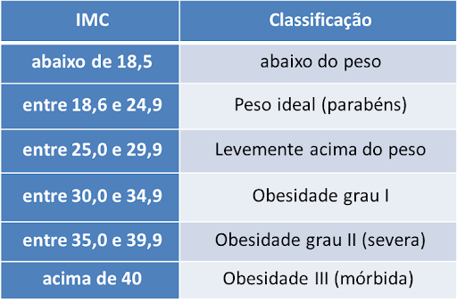

```{r}
#| echo: false
#| warning: false

# Bibliotecas

pacman::p_load(gt, knitr, tidyverse)
```

Toda grande análise começa com coisas simples: somar, comparar, organizar. Parece básico, e é mesmo. Mas é como aprender acordes no violão: no começo são só posições, depois viram música. Aqui você começa a perceber que pequenas operações, quando bem feitas, viram raciocínios poderosos.

::: {.panel-tabset}

## ➕ Operações aritméticas e lógicas

### Operações aritméticas

As operações aritméticas são usadas para fazer **contas com números** e a saída sempre são **números**.

```{r}
#| echo: false

operadores_df <- data.frame(
  Operador = c("+", "-", "*", "/", "%%", "%/%", "^"),
  Descricao = c(
    "Adição",
    "Subtração",
    "Multiplicação",
    "Divisão",
    "Resto da divisão",
    "Divisão inteira",
    "Exponenciação"
  ),
  Exemplo = c(
    "5 + 3",
    "10 - 5",
    "3 * 5",
    "10 / 2",
    "10 %% 4",
    "11 %/% 3",
    "2 ^ 3"
  ),
  Resultado = c(8, 5, 15, 5, 2, 3, 8))

operadores_df %>%
  gt() %>%
    cols_align(
    align = "center"
  ) %>%
    cols_label(
    Operador = md("**Operador**"),
    Descricao = md("**Descrição**"),
    Exemplo = md("**Exemplo**"),
    Resultado = md("**Resultado**")
  ) %>%
  text_transform(
    locations = cells_body(columns = Operador),
    fn = function(x) {
      paste0(
        "<span style='background-color:#d8b4fe;
             padding:2px 6px;
             border-radius:6px;
             font-weight:500;'>",
        x,
        "</span>"
      )
    }
  ) %>%
  tab_options(
    table.align = "left"
  )
```

### Operações lógicas

Já as operações lógicas são usadas para fazer **comparações** ou **decisões** e a saída pode ser `TRUE` ou `FALSE`.

```{r}
#| echo: false

op_logic <- data.frame(
  Operador = c('==', '!=', '<', '<=', '>', '>=', '!x', 'x | y', 'x & y', 'x %in% y'), 
  Significado = c('igual a', 'diferente de', 'menor que', 'menor ou igual a', 'maior que', 'maior ou igual a', 'negação de x', 'x OU y', 'x E y', 'x está contido em y'),
  Exemplo = c('1 == 1', '3 != 3', '4 < 4', '2 <= 2', '5 > 3', '9 >= 8', '!(3 != 3)', '(1 == 1) | (3 != 3)', '(1 == 1) & (3 != 3)', 'c(1, 2) %in% c(1, 2, 3, 4)'),
  Resultado = c('TRUE', 'FALSE', 'FALSE', 'TRUE', 'TRUE', 'TRUE', 'TRUE', 'TRUE', 'FALSE', 'TRUE TRUE')
)


op_logic %>%
  gt() %>%
  cols_align(
    align = "center"
  ) %>%
    cols_label(
    Operador = md("**Operador**"),
    Significado = md("**Significado**")
  ) %>%
  text_transform(
    locations = cells_body(columns = Operador),
    fn = function(x) {
      paste0(
        "<span style='background-color:#d8b4fe;
             padding:2px 6px;
             border-radius:6px;
             font-weight:500;'>",
        x,
        "</span>"
      )
    }
  ) %>%
  tab_options(
    table.align = "left"
  )
```

No caso de `x | y`, é preciso que pelo menos uma das condições seja verdadeira para retornar `TRUE`, caso contrário, retornará `FALSE`. Enquanto para `x & y`, todas as condições precisam ser verdadeiras para retornar `TRUE`, senão, retornará `FALSE`. Já para `x %in% y`, tanto `x` quanto `y` são **vetores**, cuja definição será abordada mais adiante.

::: {.callout-note}

### Prática 2.01: Cálculo e classificação de IMC

Davi tem 19 anos, 1,68m de altura e pesa 72kg.

**a)** Calcule o IMC de Davi usando operadores aritméticos. A fórmula é: peso dividido pela altura ao quadrado.

**b)** A tabela abaixo mostra as classificações do IMC. Use operadores lógicos para verificar se o IMC de Davi se enquadra em cada uma delas.



**c)** Verifique se o IMC de Davi está na faixa de peso normal (entre 18,5 e 24,9).

**d)** Ana tem IMC 20,4. Use operadores lógicos para verificar se pelo menos um dos dois está acima do peso normal, e depois se os dois estão.

:::

## 🏷️ Variáveis, classes e objetos

O nome das variáveis podem conter **letras**, **números**, **pontos** (.) e **sublinhados** (\_), mas devem começar com uma **letra**. Lembre-se também que **MAIÚSCULAS** e **minúsculas** são consideradas **diferentes**.

**As principais classes de objetos são:**

- `numeric`: números, que podem ser **inteiros**, sem casas decimais, ou **reais**, com casas decimais.

- `character`: textos.

- `logical`: **TRUE** ou **FALSE**.

- `factor`: categorias.

No código abaixo, foi atribuido à variável `variavel_numerica` um objeto de classe `numeric` com valor `2.5`.

```{r}
#| eval: false

# atribuição
variavel_numerica <- 2.5 
# imprime o valor da variável
variavel_numerica

# imprime a classe da variável
class(variavel_numerica)
```

```{r}
#| echo: false

# atribuição
variavel_numerica <- 2.5 
# imprime o valor da variável
variavel_numerica

# imprime a classe da variável
class(variavel_numerica)
```

Abaixo, a variável `variavel_numerica` é convertida para texto com a função `as.character`. Observe também que textos são escritos entre aspas.

```{r}
#| eval: false

# converte 'variavel_numerica' para texto (character)
variavel_textual <- as.character(variavel_numerica)
variavel_textual

# imprime a classe da variável 'variavel_textual'
class(variavel_textual)

# reatribui um valor para a variavel 'variavel_textual'
variavel_textual <- "dois ponto cinco"
variavel_textual
```

```{r}
#| echo: false

# converte 'variavel_numerica' para texto (character)
variavel_textual <- as.character(variavel_numerica)
variavel_textual

# imprime a classe da variável 'variavel_textual'
class(variavel_textual)

# reatribui um valor para a variavel 'variavel_textual'
variavel_textual <- "dois ponto cinco"
variavel_textual
```

Agora, obtém-se uma variável lógica a partir das variáveis `variavel_numerica` e `variavel_textual`.

```{r}
#| eval: false

# verifica se 2.5 é igual a "dois ponto cinco", a partir do operador lógico '=='
verificacao <- variavel_numerica == variavel_textual
verificacao

class(verificacao)

# pergunta se a variável 'verificacao' armazena um objeto de classe 'logical'
is.logical(verificacao)
```

```{r}
#| echo: false

# verifica se 2.5 é igual a "dois ponto cinco", a partir do operador lógico '=='
verificacao <- variavel_numerica == variavel_textual
verificacao

class(verificacao)

# pergunta se a variável 'verificacao' armazena um objeto de classe 'logical'
is.logical(verificacao)
```

---

::: {.callout-note}

### Prática 2.02: Variáveis e classes

Agora que você já calculou o IMC de Davi manualmente, vamos organizar essas informações em variáveis.

**a)** Crie variáveis para o nome, idade, altura e peso de Davi. Use class() para confirmar a classe de cada uma.

**b)** Calcule e armazene o IMC de Davi em uma variável. Em seguida, use is.numeric() para confirmar que o resultado é numérico.

**c)** Crie uma variável em_peso_normal que armazene o resultado da verificação lógica do item c) da prática anterior. Qual a classe dessa variável?

:::

## 🔢 Vetores e seleção de elementos

Vetores armazenam vários elementos de mesma classe.

### Como criar vetores

```{r}
# vetor de nomes
vetor_de_nomes <- c("Bernardo", "Danilo", "José", "Emanuel", "Kauann", "Guilherme")
vetor_de_nomes
```

```{r}
# vetor de números
vetor_de_numeros <- c(0, 1, 2, 3, 4, 5, 6, 7, 8, 9)
# é o mesmo que:
vetor_de_numeros <- seq(0, 9, 1) # sequência de 0 a 9, saltando de 1 em 1
# ou:
vetor_de_numeros <- 0:9
vetor_de_numeros
```

```{r}
# segundo vetor de números
vetor_de_numeros_2 <- c(3, 3, 3, 3, 3)
# é o mesmo que:
vetor_de_numeros_2 <- rep(3, 5) # repetir o número 3 cinco vezes
vetor_de_numeros_2
```

::: {.callout-note}

### Prática 2.03: Criando vetores numéricos

Crie os vetores abaixo usando a forma mais curta possível:

**a)** Números de 1 a 10.

**b)** Números de 0 a 100, de 10 em 10.

**c)** O número 5 repetido 8 vezes.

:::

### Selecionar elementos por índice

Cada elemento possui um **indexador associado**, de modo que o primeiro elemento possui índice 1, o segundo possui índice 2, e assim por diante.

Ou seja, "*Bernardo*" possui índice 1, "*Danilo*" possui índice 2, "*José*" possui índice 3, e assim por diante.

```{r}
# seleciona um elemento
vetor_de_nomes[2]
```

```{r}
# seleciona elementos seguidos
vetor_de_nomes[2:5]
```

```{r}
# seleciona elementos em posições específicas
vetor_de_nomes[c(2,6)]
```

### Selecionar elementos com lógica

```{r}
# seleciona os nomes diferentes de "Kauann"
vetor_de_nomes[vetor_de_nomes != "Kauann"]
```

```{r}
# seleciona os elementos numéricos maiores do que 3
vetor_de_numeros[vetor_de_numeros > 3]
```

::: {.callout-note}

### Prática 2.04: Selecionando elementos dos vetores

O vetor abaixo representa os batimentos cardíacos (bpm) medidos de 8 pacientes:

```{r}
bpm <- c(72, 85, 91, 68, 77, 104, 83, 95)
```

**a)** Selecione o terceiro valor do vetor.

**b)** Selecione os valores do segundo ao quinto elemento. 

**c)** Selecione apenas os valores acima de 90 bpm.  

**d)** Quantos pacientes têm bpm acima de 90? Use `sum()`.

:::

:::