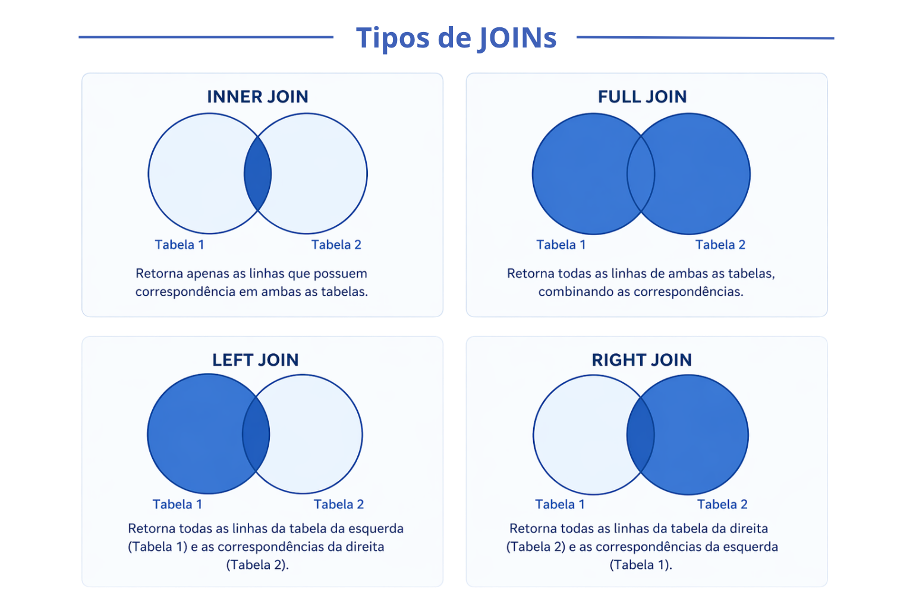

```{r}
#| echo: false
#| message: false
#| warning: false

pacman::p_load(gt, knitr, readxl, rio)

source('tratado.r')
```

Agora imagine pegar várias tabelas soltas e transformá-las em uma única história coerente. Aqui você começa a "moldar" os dados: filtrar, juntar, organizar. É como montar um quebra-cabeça — só que você decide quais peças entram e qual imagem final quer revelar.

::: {.panel-tabset}

## 🔗 Junção de tabelas

No curso, temos 5 tabelas separadas que descrevem os mesmos participantes. Todas compartilham uma coluna `id`, que identifica unicamente cada indivíduo. Esse `id` é a chave para unir as tabelas com a função `merge()`.

[Acesse aqui](https://raw.githubusercontent.com/EmanuelFPS/introducao-ao-r/main/tratado.R) o comando para tratar as tabelas se precisar.



Os principais tipos de junção são controlados pelos argumentos `all.x` e `all.y`:

```{r}
#| echo: false

joins_df <- data.frame(
  Chamada = c(
    'merge(A, B, by="id")',
    'merge(A, B, by="id", all.x=TRUE)',
    'merge(A, B, by="id", all.y=TRUE)',
    'merge(A, B, by="id", all=TRUE)'
  ),
  Equivalente = c("inner join", "left join", "right join", "full join"),
  Descrição = c(
    "Mantém apenas as linhas com correspondência nas duas tabelas.",
    "Mantém todas as linhas de A. Linhas sem par em B viram NA.",
    "Mantém todas as linhas de B. Linhas sem par em A viram NA.",
    "Mantém todas as linhas de ambas as tabelas."
  )
)

joins_df %>%
  gt() %>%
  cols_align(align = "left") %>%
  cols_label(
    Chamada     = md("**Chamada**"),
    Equivalente = md("**Equivalente**"),
    Descrição   = md("**Descrição**")
  ) %>%
  text_transform(
    locations = cells_body(columns = Chamada),
    fn = function(x) {
      paste0(
        "<span style='background-color:#d8b4fe;
               padding:2px 6px;
               border-radius:6px;
               font-weight:500;
               font-family:monospace;'>",
        x, "</span>"
      )
    }
  ) %>%
  tab_options(table.align = "left")
```

O `all.x = TRUE` (left join) é o mais usado no dia a dia: você parte de uma tabela principal e vai incorporando informações das demais.

```{r}
# unir demografico com laboratorio pela coluna 'id'
dados <- merge(demografico, laboratorio, by = "id", all.x = TRUE)

# unir com mais tabelas em sequência
dados <- merge(dados, saude_percebida, by = "id", all.x = TRUE)
dados <- merge(dados, medidas_fisicas, by = "id", all.x = TRUE)
dados <- merge(dados, habitos,         by = "id", all.x = TRUE)
```

::: {.callout-note}

### Prática 4.01: Unindo tabelas

**a)** Una as tabelas `demografico`, `laboratorio`, `saude_percebida`, `medidas_fisicas` e `habitos` usando `merge()` com `all.x = TRUE` e salve o resultado no objeto `dados`.

**b)** Quantas linhas e colunas a base unificada tem? Use `dim()`.

**c)** Quais são os nomes das colunas? Use `colnames()`.

:::

## 🔄 Reordenação

### Reordenar colunas

Após unir tabelas, pode ser útil reorganizar a ordem das colunas.

```{r}
# colocar 'id' e 'nome' primeiro, mantendo o restante
dados <- dados[, c("id", "nome", colnames(dados)[!colnames(dados) %in% c("id", "nome")])]
```

### Reordenar linhas

```{r}
#| eval: false

# ordenar por idade (crescente)
demografico[order(demografico$idade), ]

# ordenar por renda (decrescente)
demografico[order(demografico$renda_reais, decreasing = TRUE), ]

# ordenar por estado civil e, dentro de cada grupo, por idade
demografico[order(demografico$estado_civil, demografico$idade), ]
```


## ✏️ Criar e transformar variáveis

Novas colunas são criadas atribuindo valores diretamente com `$`.

```{r}
#| eval: false

# criar uma coluna com a renda em salários mínimos (R$ 120,00 em 1997)
demografico$renda_sm <- round(demografico$renda_reais / 120, 2)
```

### Condicionais com `ifelse()`

A função `ifelse()` cria uma variável com base em uma condição: se a condição for verdadeira, atribui um valor; caso contrário, atribui outro.

```{r}
#| eval: false

# criar variável binária de renda
demografico$baixa_renda <- ifelse(demografico$renda_reais < 120, "Sim", "Não")
```

### Condicionais múltiplas com `ifelse()` aninhado

Quando há mais de duas categorias, os `ifelse()` podem ser aninhados um dentro do outro.

```{r}
# categorizar escolaridade em níveis
demografico$nivel_escolaridade <- ifelse(
  demografico$escolaridade_anos == 0,  "Sem instrução",
  ifelse(demografico$escolaridade_anos <= 4,  "Fundamental I",
  ifelse(demografico$escolaridade_anos <= 8,  "Fundamental II",
  ifelse(demografico$escolaridade_anos <= 11, "Médio",
  ifelse(demografico$escolaridade_anos > 11,  "Superior", NA)))))

unique(demografico$nivel_escolaridade)
```

::: {.callout-note}

### Prática 4.02: Criando uma variável nova

No banco `demografico`, crie uma variável chamada `baixa_renda` que vale `"Sim"` se a renda for menor que R$ 120 e `"Não"` caso contrário. Use `ifelse()`.

Em seguida, use `table()` para ver quantos participantes estão em cada categoria.

::: {.callout-tip collapse="true"}
## Ajuda

```r
demografico$baixa_renda <- ifelse(demografico$renda_reais < 120, "Sim", "Não")
table(demografico$baixa_renda)
```
:::

---

:::

## 📊 Agrupar e resumir com `aggregate()`

A função `aggregate()` calcula uma estatística para uma variável e separada por grupos, como por exemplo a média de renda por sexo ou por estado civil.

```{r}
# média de renda por sexo
aggregate(renda_reais ~ sexo, data = demografico, FUN = mean)

# média de renda e idade por sexo (múltiplas variáveis resposta)
aggregate(cbind(renda_reais, idade) ~ sexo, data = demografico, FUN = mean)

# média de renda por sexo e estado civil (múltiplos grupos)
aggregate(renda_reais ~ sexo + estado_civil, data = demografico, FUN = mean)
```

Para contar observações por grupo, usa-se `table()`.

```{r}
# contagem por estado civil
table(demografico$estado_civil)

# proporção (em %)
round(prop.table(table(demografico$estado_civil)) * 100, 1)
```

As principais funções usadas dentro do `aggregate()` são:

```{r}
#| echo: false

resumo_df <- data.frame(
  Função = c("mean(x)", "sum(x)", "median(x)", "sd(x)", "min(x)", "max(x)", "length(x)"),
  Descrição = c(
    "Calcula a média de x",
    "Soma os valores de x",
    "Calcula a mediana de x",
    "Calcula o desvio padrão de x",
    "Retorna o menor valor de x",
    "Retorna o maior valor de x",
    "Conta o número de elementos de x"
  )
)

resumo_df %>%
  gt() %>%
  cols_align(align = "left") %>%
  cols_label(
    Função    = md("**Função**"),
    Descrição = md("**Descrição**")
  ) %>%
  text_transform(
    locations = cells_body(columns = Função),
    fn = function(x) {
      paste0(
        "<span style='background-color:#d8b4fe;
               padding:2px 6px;
               border-radius:6px;
               font-weight:500;
               font-family:monospace;'>",
        x, "</span>"
      )
    }
  ) %>%
  tab_options(table.align = "left")
```

::: {.callout-important}
Sempre use `na.rm = TRUE` nas funções de resumo quando houver valores nulos. Sem esse argumento, o resultado será `NA` se houver qualquer valor faltante. Exemplo: `aggregate(renda_reais ~ sexo, data = demografico, FUN = mean, na.rm = TRUE)`.
:::

::: {.callout-note}

### Prática 4.03: Resumindo por grupo

Use a função `aggregate()` para calcular a **média de renda** separada por **estado civil** no banco `demografico`.

::: {.callout-tip collapse="true"}
## Ajuda

```r
aggregate(renda_reais ~ estado_civil, data = demografico, FUN = mean, na.rm = TRUE)
```

A fórmula `variavel ~ grupo` significa: "calcule a variável separada por grupo".
:::

:::

::: {.callout-note}

### Prática 4.04: Conhecendo os participantes

Use o banco `demografico` para responder:

**a)** Quantos participantes há de cada sexo? Use `table()`.

**b)** Quantos participantes há de cada estado civil? Use `table()`.

**c)** Ordene o banco por idade em ordem decrescente. Quem são os 3 participantes mais velhos? Mostre apenas `nome` e `idade`.

::: {.callout-tip collapse="true"}
## Ajuda

```r
# a)
table(demografico$sexo)

# b)
table(demografico$estado_civil)

# c)
ordenado <- demografico[order(demografico$idade, decreasing = TRUE), ]
ordenado[1:3, c("nome", "idade")]
```
:::

:::

::: {.callout-note}

### Prática 4.05: Classificando o IMC

O banco `medidas_fisicas` contém a variável `imc`. Crie uma variável chamada `classif_imc` usando a tabela abaixo:

| Classificação | IMC |
|---|---|
| `"Abaixo do peso"` | < 18,5 |
| `"Peso normal"` | 18,5 a 24,9 |
| `"Sobrepeso"` | 25,0 a 29,9 |
| `"Obesidade"` | ≥ 30,0 |

**a)** Crie a variável com `ifelse()` aninhado.

**b)** Use `table()` para ver quantos participantes há em cada categoria.

::: {.callout-tip collapse="true"}
## Ajuda

O `ifelse()` aninhado funciona assim: dentro do "senão" de um `ifelse()`, você coloca outro `ifelse()`.

```r
medidas_fisicas$classif_imc <- ifelse(
  medidas_fisicas$imc < 18.5, "Abaixo do peso",
  ifelse(medidas_fisicas$imc < 25, "Peso normal",
  ifelse(medidas_fisicas$imc < 30, "Sobrepeso",
                                   "Obesidade")))

table(medidas_fisicas$classif_imc)
```
:::

:::

:::