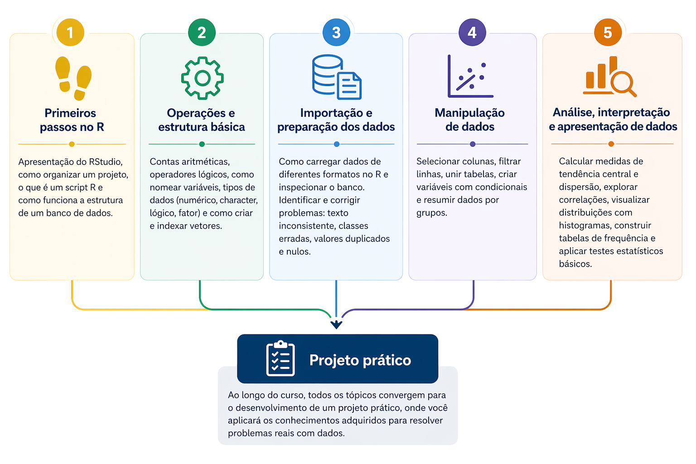

R é uma linguagem e ambiente computacional voltado à análise estatística de dados. Trata-se de um software livre, desenvolvido a partir da linguagem S, que oferece ferramentas robustas para manipulação, visualização e modelagem de dados.

## 🎯 Objetivos do curso

Este curso é uma iniciativa de extensão do [Grupo de Pesquisa e Ensino em Nutrição e Saúde Coletiva (GPENSC)](https://www.instagram.com/gpenscufop/) da **Universidade Federal de Ouro Preto**, voltada para profissionais e estudantes da área da saúde que desejam dar os primeiros passos na análise de dados com o software R. A proposta parte de situações práticas do contexto epidemiológico, permitindo que o participante desenvolva habilidades reais de organização, manipulação e interpretação de dados em saúde.

## 📚 Estrutura do Curso 

O conteúdo está organizado em módulos progressivos, combinando teoria e prática com exemplos reais, e está dividido nos seguintes tópicos:



### Projeto Bambuí

Os dados utilizados ao longo do curso são sintéticos, inspirados no **Projeto Bambuí**, um dos estudos epidemiológicos longitudinais mais importantes já realizados no Brasil, que acompanhou por décadas uma coorte de idosos em Minas Gerais e gerou evidências fundamentais sobre envelhecimento, doenças crônicas e determinantes sociais de saúde no país. Trabalhar com dados desse contexto significa que cada linha de código que você escrever aqui tem um paralelo direto com análises reais que moldaram políticas públicas brasileiras. O curso utiliza cinco tabelas interligadas:

- **demografico**: informações pessoais e socioeconômicas dos 1.609 participantes;
- **laboratorio**: resultados de exames de sangue;
- **medidas_fisicas**: peso, altura, IMC e pressão arterial;
- **saude_percebida**: autopercepção de saúde, condições crônicas e uso de medicamentos;
- **habitos**: informações sobre alimentação, atividade física e consumo de substâncias.

Ao longo dos tópicos, você vai importar e inspecionar essas tabelas, identificar e corrigir inconsistências, uni-las por um identificador comum, criar e transformar variáveis, calcular medidas descritivas e aplicar testes estatísticos, construindo, passo a passo, o mesmo tipo de análise que pesquisadores usam para entender a saúde de populações inteiras.

### Vigilância epidemiológica em Minas Gerais

Já os dados do **Projeto Prático** foram simulados com base no perfil epidemiológico típico de municípios mineiros, representando 500 indivíduos de 10 cidades diferentes. Ao longo das questões, você vai colocar em prática tudo que aprendeu no curso, desde a limpeza e padronização dos dados até a construção de variáveis, análise descritiva, visualizações e testes estatísticos, chegando a conclusões reais sobre a prevalência de uma doença crônica e seus fatores associados.

## ▶️ Demonstrações

As demonstrações utilizam dados simulados, inspirados em situações epidemiológicas reais, com o objetivo de facilitar o entendimento dos conceitos apresentados.

::: {.panel-tabset}

### Histogramas

Simula medições de pressão arterial de vários pacientes e mostra como esses valores se distribuem. Útil para identificar o que é comum e o que foge do padrão.

```{r}
pressao <- rnorm(1000, mean = 120, sd = 15)
hist(pressao, col = "lightblue", main = "Distribuição da pressão arterial")
```

### Testes estatísticos

Compara níveis de glicemia entre dois grupos (por exemplo, com e sem intervenção) e verifica se a diferença observada pode ser considerada real.

```{r}
dados <- data.frame(
  grupo = rep(c("Controle", "Tratamento"), each = 50),
  glicemia = rnorm(100, mean = rep(c(100, 90), each = 50))
)

t.test(glicemia ~ grupo, data = dados)
```

### Simulação de amostragem

Simula 5 coletas diferentes de pacientes e calcula a média de cada uma, mostrando como os resultados podem variar entre amostras, mesmo em condições semelhantes.

```{r}
medias <- numeric(5)

for(i in 1:5){
  medias[i] <- mean(rnorm(100, mean = 100))
}

medias
```

### Séries temporais

Representa a evolução de casos ao longo do tempo, ajudando a visualizar tendências de crescimento em um acompanhamento epidemiológico.

```{r}
dias <- 1:10
casos <- dias^2
plot(dias, casos, type = "b")
```


:::

## 🙏 Agradecimentos

Agradeço à Profa. **Raquel de Deus Mendonça** pelo convite, à Profa. **Ariene Silva do Carmo** pela idealização do projeto, ao Prof. **Tiago Martins Pereira** pela autorização para uso dos códigos na elaboração do material e ao Prof. **Fernando Luiz Pereira de Oliveira** pela revisão. A participação de todos foi fundamental para a realização deste curso.


## 📖 Referências 

BATTISTI, Iara Denise Endruweit; SMOLSKI, Felipe Micail da Silva (orgs.). **Software R: Análise estatística de dados utilizando um programa livre**. Bagé: Faith, 2019. Disponível em: http://www.editorafaith.com.br/ebooks/grat/978-85-68221-44-0.pdf.

COSTA, Maria Fernanda F. Lima et al. **The Bambuí health and ageing study (BHAS): methodological approach and preliminary results of a population-based cohort study of the elderly in Brazil.** Revista de Saúde Pública, v. 34, p. 126-135, 2000.

LIMA E COSTA, Maria Fernanda F. de et al. **Projeto Bambuí: um estudo epidemiológico de características sociodemográficas, suporte social e indicadores de condição de saúde dos idosos em comparação aos adultos jovens**. Informe epidemiológico do SUS, v. 10, n. 4, p. 147-161, 2001.

WICKHAM, Hadley; ÇETINKAYA-RUNDEL, Mine; GROLEMUND, Garrett. **R for Data Science**. 2. ed. Disponível em: https://pt.r4ds.hadley.nz/.

